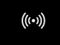
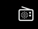
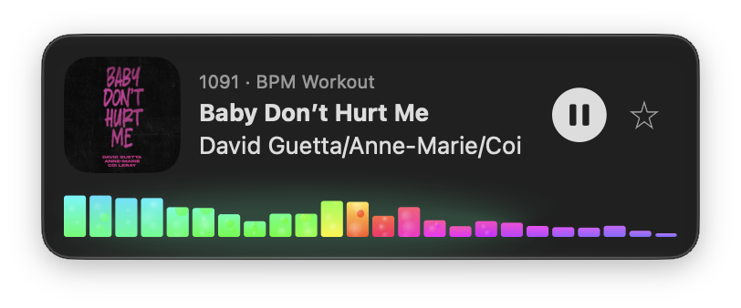
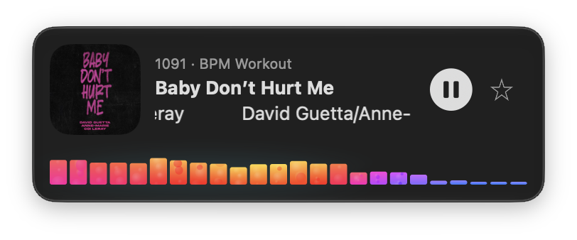
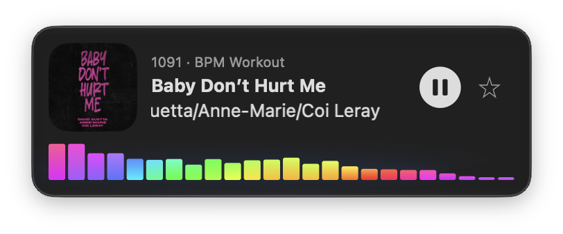

# 📻 StarPlayrX

**A lightweight, fully accessible SiriusXM player for Mac, built for people who use VoiceOver.**

StarPlayrX was built for visually impaired listeners, a group of paying subscribers that SiriusXM has long ignored. It aims for 100% VoiceOver support, a small CPU and memory footprint, and low-latency streaming.

🤖 Built by the makers of **[Agent!](https://github.com/AgentiLoop/Agent)**, an autonomous macOS agent.

---

## ✨ What's in this repo

| Folder | What it is |
| --- | --- |
| [`StarPlayrXMac/`](StarPlayrXMac) | **New:** a native SwiftUI menu bar app for macOS |
| [`StarPlayrX/`](StarPlayrX) | The original Mac Catalyst App. May not work, unsupported, abandoned. |
| `StarPlayrRadioKit/` | Legacy SiriusXM API layer and local HLS streaming server, still used by the iOS app ([iOS](StarPlayrX/StarPlayrX/StarPlayrX/StarPlayrX/StarPlayrRadioKit)). Removed from the Mac app; see the [`legacy-api`](https://github.com/AgentiLoop/StarPlayrX/tree/legacy-api) tag |
| `SwifterLite/` | Small embedded HTTP server used by StarPlayrRadioKit ([iOS](StarPlayrX/StarPlayrX/StarPlayrX/StarPlayrX/SwifterLite)) |


## 🎛️ StarPlayrX for Mac (menu bar app)

<p align="center">
  
</p>

<table align="center">
  <tr>
    <td align="center" valign="top" width="33%">
      <br>
      <b>📻 Menu bar panel</b><br>
      Now playing, the lava-lamp equalizer and a searchable list of every channel with what's on it right now
    </td>
    <td align="center" valign="top" width="33%">
      <br>
      <b>✂️ Tear-off window</b><br>
      Drag the panel off the menu bar and it becomes its own floating window you can park anywhere
    </td>
    <td align="center" valign="top" width="33%">
      <br>
      <b>🎬 Window shade</b><br>
      Double-click the header to roll the window up to just what's playing and the equalizer
    </td>
  </tr>
</table>

- Lives in the menu bar (📻) with no Dock icon. The icon shows whether something is playing:

<table>
  <tr>
    <td align="center" valign="top"><br><b>Playing</b></td>
    <td align="center" valign="top"><br><b>Not playing</b></td>
  </tr>
</table>

- **Tear-off window:** drag the panel off the menu bar and it becomes a floating window you can park anywhere. Click the 📻 icon to show or hide it
- **Window shade:** double-click the header to roll the window up to just what's playing and the equalizer, and again to roll it back down. Moves between menu, tear-off and shade are animated
- **Lava-lamp color equalizer:** 60 fps bars worked out from the audio as it's decoded, before it plays, so they stay in step with the music and need no "record system audio" permission. Works on macOS 13 Ventura and later (it used to need macOS 14.2). Drifting colors, a glow that pulses on the beat, and a darker glow on light backgrounds
- **Lava-lamp bubbles:** soft bubbles rise inside the bars, faster when the music is louder, swelling and shrinking like wax in a lava lamp. **Single-click the bars to switch modes:** Bubbles → Soft Bubbles → No Bubbles → back to Bubbles. A little speech bubble pops up where you clicked to name the mode, and your choice is remembered (Soft Bubbles is the default). Double-clicking the bars still rolls the window up

<table align="center">
  <tr>
    <td align="center" valign="top" width="33%"><br><b>🫧 Bubbles</b></td>
    <td align="center" valign="top" width="33%"><br><b>☁️ Soft Bubbles</b></td>
    <td align="center" valign="top" width="33%"><br><b>▮ No Bubbles</b></td>
  </tr>
</table>

- **Stars (presets):** every channel row has a star; click it to add the channel to your presets or take it out. The star beside the play button stars the playing channel, and the star beside the search field shows just your starred channels. Stars are kept on this Mac, under the same key and with the same starting set as the iOS app
- **Liquid Glass** look on macOS 26 and later
- **AppleScript support:** play, stop, resume, and step through channels, read what each channel shows and what's actually playing (artist, song, artwork), list channels by category, search, scroll, tear off, park, and shade the window, pick the bubble mode. Open the StarPlayrX dictionary in Script Editor to see every command
- Search channels, artists and songs
- Shows what's playing on the current channel and every channel in the list, with album art that stays put for the whole song
- **Now Playing matches what you hear:** on live channels the song shown is held back by how far the audio runs behind the live feed, so it changes when the song you hear changes. The channel list's song info refreshes 3 times a minute. Long titles scroll instead of getting cut off
- Xtra channels (1000+), searchable with "xtra" or "music"; tuning in plays the song the list shows
- **Modern API, no local server:** every channel, live and Xtra, comes from one modern API; live audio plays straight from the stream (better sound, fewer things to troubleshoot) and tunes in well under a second
- Play/pause from the keyboard media keys and Control Center, with the album art or channel art showing there too
- Picks up where you left off: the last channel you played starts again when StarPlayrX opens
- US and Canada accounts (pick Canada on the sign-in screen)
- Your password is stored only in the macOS Keychain

**Requirements:** macOS 13 Ventura or later, Apple Silicon or Intel, and an active SiriusXM subscription.

**Download:** [StarPlayrX for Mac 1.1.15](https://github.com/AgentiLoop/StarPlayrX/releases/tag/mac-1.1.15) (signed and notarized). All builds are on the [Releases](https://github.com/AgentiLoop/StarPlayrX/releases) page.

### 📜 AppleScript

```applescript
tell application "StarPlayrX"
    wait until ready                     -- right after launch, while the Keychain sign-in runs
    play channel "1009"
    get {shown artist, shown song}       -- what the list shows
    get {playing artist, playing song}   -- what's actually playing
    get {shown artwork, current channel logo}
    next channel                         -- step through the list (as filtered by search text)
    set bubble mode to no bubbles        -- bubbles / soft bubbles / no bubbles
    sign in user "me@example.com" password "…"
    park menu at upper right
    toggle shade
end tell
```

Every property and command is in the StarPlayrX dictionary (open the app in Script Editor): sign-in state, channels (numbers, names, categories, logos, Xtra or live), what each channel shows and plays, the panel (show, hide, tear off, reattach, park, shade, drag, search, scroll), the equalizer's bubble mode, and show-art per channel.

### 🔌 Modern API

As of 1.1.15, StarPlayrX for Mac runs entirely on the Modern API: one sign-in, one channel list (live and Xtra), one way to play. The legacy player path (`StarPlayrRadioKit`, its embedded HTTP server and the playlist rewriting it did) is gone, about 3,500 lines of it. Live audio now reaches the player straight from the signed HLS stream instead of through a local proxy, so it sounds the way the source does, tunes in well under a second, and there is a lot less to go wrong (no local port, no server to restart, no second sign-in).

Sign-in is a short chain (register a device → anonymous session → password → authenticated session) that yields a bearer token. A channel is tuned with one call that returns signed HLS URLs. Xtra channels are played track by track (each track is an encrypted clip with its own key); live channels are an ordinary AES-128 HLS stream with about five hours of rewind. For live channels the playlists and the key request go through the app (`LiveLoader`), because the key endpoint needs the bearer token; the audio segments themselves are plain signed URLs the player fetches directly. The newest segments are also decoded in the background to drive the equalizer.

**Canada:** the same API serves both countries; which channels you get is decided by your account. The Canada checkbox on the sign-in screen switches the request locale to `en-CA`.

Your username and password are kept only in the macOS Keychain, and what's-playing info for every live channel comes from an unauthenticated "look around" feed.

The last version with the legacy path is tagged [`legacy-api`](https://github.com/AgentiLoop/StarPlayrX/tree/legacy-api).

## 🛠️ Building

You need Xcode 16 or later.

### Mac menu bar app

**In Xcode:**
1. Open `StarPlayrXMac/StarPlayrXMac.xcodeproj`
2. Pick the `StarPlayrXMac` scheme and press **⌘R**
3. Look for 📻 in the menu bar

To sign with your own account, change the team under **Signing & Capabilities**, or edit `DEVELOPMENT_TEAM` in `project.yml`.

**From the command line:**
```sh
cd StarPlayrXMac
xcodebuild -project StarPlayrXMac.xcodeproj -scheme StarPlayrXMac \
  -configuration Release -derivedDataPath build \
  ARCHS="arm64 x86_64" ONLY_ACTIVE_ARCH=NO build
open build/Build/Products/Release/StarPlayrX.app
```

**Regenerating the project (optional):** the Xcode project is generated from `StarPlayrXMac/project.yml` with [XcodeGen](https://github.com/yonaskolb/XcodeGen).
```sh
brew install xcodegen
cd StarPlayrXMac && xcodegen generate
```

### Catalyst / iOS / iPadOS app

Open `SPX.xcworkspace`, choose the `StarPlayrX` scheme and a destination, then build. iOS and iPadOS builds have to be built and installed locally.

### Release: Developer ID and notarization

```sh
APP=build/Build/Products/Release/StarPlayrX.app
codesign --force --options runtime --timestamp \
  --sign "Developer ID Application: <Your Name> (<TEAMID>)" "$APP"
ditto -c -k --keepParent "$APP" StarPlayrX.zip
xcrun notarytool submit StarPlayrX.zip --keychain-profile "<profile>" --wait
xcrun stapler staple "$APP"
ditto -c -k --keepParent "$APP" StarPlayrX-Mac.zip
```

Re-sign after `xcodebuild`. This turns on the hardened runtime and removes the `get-task-allow` entitlement, which notarization rejects.

## 🩺 Troubleshooting

**Static, hissing or popping on macOS 26:** while audio is playing, run this in Terminal:
```sh
sudo killall coreaudiod
```
More details: [How to fix popping sounds on macOS 26](https://medium.com/tech-blog-today/how-to-fix-popping-sounds-on-macos-26-c2846fc65ad0)

**Nothing plays:** check that your SiriusXM subscription is active and that you're online. Streaming needs an internet connection.

## 📜 License and trademarks

- See [LICENSE](LICENSE).
- The StarPlayr trademark is owned by NiceMac LLC and licensed exclusively to StarPlayrX.com.
- All material is Copyright © 2025–2026 StarPlayrX.com.
- NiceMac LLC is not affiliated with SiriusXM or its subsidiaries.

## 🌐 More from us

StarPlayrX for Mac is in active development. Check out our other AgentiLoop projects too:
[agentiloop.ai](https://agentiloop.ai) · [superbox64.com](https://superbox64.com) · [inkpen.io](https://inkpen.io) · [starplayrx.com](https://starplayrx.com)

*Don't be a slacker, be a Star Player.* ⭐

---

**AgentiLoop:** [agentiloop.ai](https://agentiloop.ai/)

Copyright © 2026 AgentiLoop.ai, a Logos InkPen LLC company. All rights reserved.
