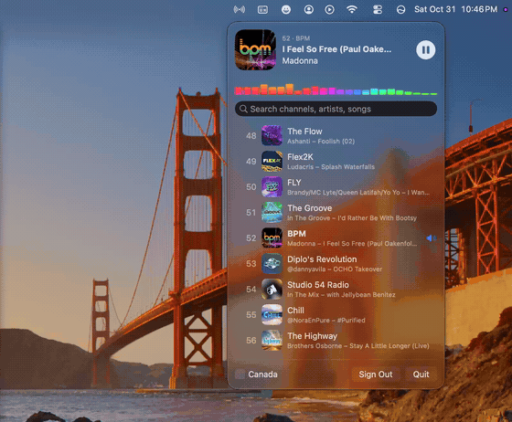
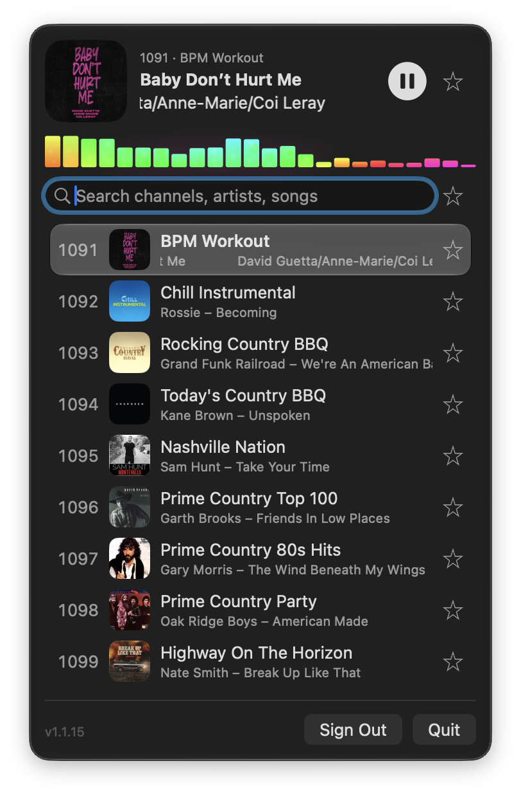
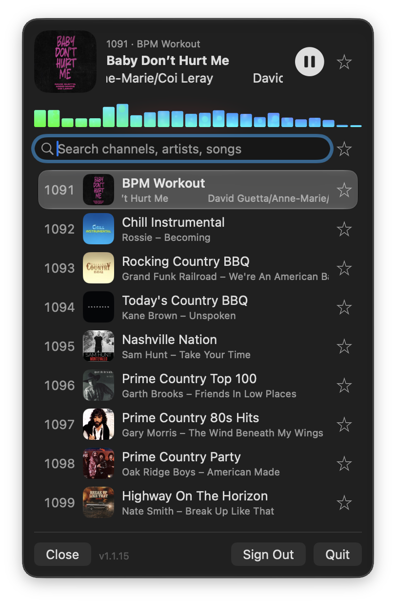
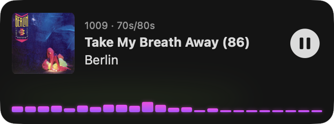

# 📻 StarPlayrX

**A lightweight, fully accessible SiriusXM player for Mac, built for people who use VoiceOver.**

StarPlayrX was built for visually impaired listeners, a group of paying subscribers that SiriusXM has long ignored. It aims for 100% VoiceOver support, a small CPU and memory footprint, and low-latency streaming.

🤖 Built by the makers of **[Agent!](https://github.com/AgentiLoop/Agent)**, an autonomous macOS agent.

---

## ✨ What's in this repo

| Folder | What it is |
| --- | --- |
| [`StarPlayrXMac/`](StarPlayrXMac) | **New:** a native SwiftUI menu bar app for macOS |
| [`StarPlayrX/`](StarPlayrX) | The original Mac Catalyst / iOS / iPadOS app (UIKit, Swift with some Objective-C) |
| [`StarPlayrRadioKit/`](StarPlayrRadioKit) | Swift package with the SiriusXM API layer and the local HLS streaming server |
| [`SwifterLite/`](SwifterLite) | Small embedded HTTP server used by StarPlayrRadioKit |
| `SPX.xcworkspace` | Xcode workspace for the Catalyst app and its packages |

## 🎛️ StarPlayrX for Mac (menu bar app)

<p align="center">
  
</p>

<table align="center">
  <tr>
    <td align="center" valign="top" width="33%">
      <br>
      <b>📻 Menu bar panel</b><br>
      Now playing, the lava-lamp equalizer and a searchable list of every channel with what's on it right now
    </td>
    <td align="center" valign="top" width="33%">
      <br>
      <b>✂️ Tear-off window</b><br>
      Drag the panel off the menu bar and it becomes its own floating window you can park anywhere
    </td>
    <td align="center" valign="top" width="33%">
      <br>
      <b>🎬 Window shade</b><br>
      Double-click the header to roll the window up to just what's playing and the equalizer
    </td>
  </tr>
</table>

- Lives in the menu bar (📻) with no Dock icon
- **Tear-off window:** drag the panel off the menu bar and it becomes a floating window you can park anywhere. Click the 📻 icon to show or hide it
- **Window shade:** double-click the header to roll the window up to just what's playing and the equalizer, and again to roll it back down. Moves between menu, tear-off and shade are animated
- **Lava-lamp color equalizer:** live bars driven by the app's own audio (Core Audio process tap + FFT), with drifting colors and a glow that pulses on the beat. Needs macOS 14.2 or later
- **Liquid Glass** look on macOS 26 and later
- **AppleScript support:** play, stop, and resume channels, read what's showing and what's actually playing, search, scroll, tear off, park, and shade the window. Open the StarPlayrX dictionary in Script Editor to see every command
- Search channels, artists and songs
- Shows what's playing on the current channel and every channel in the list
- Xtra channels (1000+), searchable with "xtra" or "music"; tuning in plays the song the list shows
- Play/pause from the keyboard media keys and Control Center
- US and Canada channel lineups
- Your password is stored only in the macOS Keychain

**Requirements:** macOS 13 Ventura or later, Apple Silicon or Intel, and an active SiriusXM subscription.

**Download:** [StarPlayrX for Mac 1.1.3](https://github.com/AgentiLoop/StarPlayrX/releases/tag/mac-1.1.3) (signed and notarized). All builds are on the [Releases](https://github.com/AgentiLoop/StarPlayrX/releases) page.

### 📜 AppleScript

```applescript
tell application "StarPlayrX"
    play channel "1009"
    get {shown artist, shown song}       -- what the list shows
    get {playing artist, playing song}   -- what's actually playing
    park menu at upper right
    toggle shade
end tell
```

## 🛠️ Building

You need Xcode 16 or later.

### Mac menu bar app

**In Xcode:**
1. Open `StarPlayrXMac/StarPlayrXMac.xcodeproj`
2. Wait for Swift Package Manager to resolve packages
3. Pick the `StarPlayrXMac` scheme and press **⌘R**
4. Look for 📻 in the menu bar

To sign with your own account, change the team under **Signing & Capabilities**, or edit `DEVELOPMENT_TEAM` in `project.yml`.

**From the command line:**
```sh
cd StarPlayrXMac
xcodebuild -project StarPlayrXMac.xcodeproj -scheme StarPlayrXMac \
  -configuration Release -derivedDataPath build \
  ARCHS="arm64 x86_64" ONLY_ACTIVE_ARCH=NO build
open build/Build/Products/Release/StarPlayrX.app
```

**Regenerating the project (optional):** the Xcode project is generated from `StarPlayrXMac/project.yml` with [XcodeGen](https://github.com/yonaskolb/XcodeGen).
```sh
brew install xcodegen
cd StarPlayrXMac && xcodegen generate
```

### Catalyst / iOS / iPadOS app

Open `SPX.xcworkspace`, choose the `StarPlayrX` scheme and a destination, then build. iOS and iPadOS builds have to be built and installed locally.

### Release: Developer ID and notarization

```sh
APP=build/Build/Products/Release/StarPlayrX.app
codesign --force --options runtime --timestamp \
  --sign "Developer ID Application: <Your Name> (<TEAMID>)" "$APP"
ditto -c -k --keepParent "$APP" StarPlayrX.zip
xcrun notarytool submit StarPlayrX.zip --keychain-profile "<profile>" --wait
xcrun stapler staple "$APP"
ditto -c -k --keepParent "$APP" StarPlayrX-Mac.zip
```

Re-sign after `xcodebuild`. This turns on the hardened runtime and removes the `get-task-allow` entitlement, which notarization rejects.

## 🩺 Troubleshooting

**Static, hissing or popping on macOS 26:** while audio is playing, run this in Terminal:
```sh
sudo killall coreaudiod
```
More details: [How to fix popping sounds on macOS 26](https://medium.com/tech-blog-today/how-to-fix-popping-sounds-on-macos-26-c2846fc65ad0)

**Nothing plays:** check that your SiriusXM subscription is active and that you're online. Streaming needs an internet connection.

## 📜 License and trademarks

- See [LICENSE](LICENSE).
- The StarPlayr trademark is owned by NiceMac LLC and licensed exclusively to StarPlayrX.com.
- All material is Copyright © 2025–2026 StarPlayrX.com.
- NiceMac LLC is not affiliated with SiriusXM or its subsidiaries.

## 🌐 More from us

We're now focused on AgentiLoop projects:
[agentiloop.ai](https://agentiloop.ai) · [superbox64.com](https://superbox64.com) · [inkpen.io](https://inkpen.io) · [starplayrx.com](https://starplayrx.com)

*Don't be a slacker, be a Star Player.* ⭐

---

**AgentiLoop:** [agentiloop.ai](https://agentiloop.ai/)

Copyright © 2026 AgentiLoop.ai, a Logos InkPen LLC company. All rights reserved.
